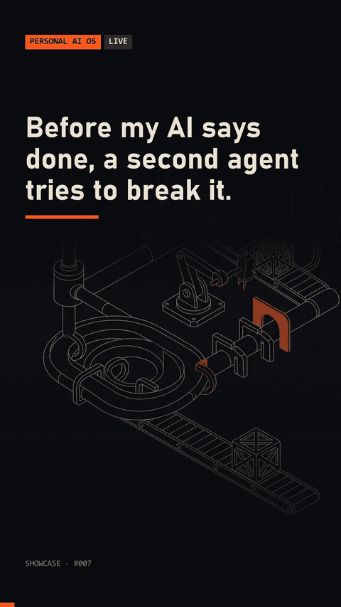

# qa-loop

A build-and-verify loop for Claude Code. A spec lists requirements, gates and tests; a builder ships a version; an adversary tries to break it and must back every PASS with evidence; the builder fixes what failed; repeat for at most 3 rounds. Hooks remind the agent to run the loop and block a "done" that has nothing behind it. The runner is plain Python, and the builder and adversary are pluggable, so the demo runs with deterministic stubs and no model.



## Quick start

```
python demo.py
```

Four scenes, all against the real engine and hooks:

1. A builder with a buggy `slugify` fails 2 of 4 gates in round 1, fixes them, and the loop closes PASS in round 2.
2. An adversary that says PASS without evidence is rejected and the loop stops.
3. A builder that ignores every fix is stopped by the stagnation rule.
4. The done-needs-evidence Stop hook, replayed on a transcript: a write followed by "done" with no read-back is blocked; with a read-back it passes.

Run the tests with `python -m unittest discover -s tests`.

To use it in Claude Code:

- Copy `skill/qa-loop/` to `.claude/skills/` so the agent knows the procedure.
- Merge `examples/settings.json` into `.claude/settings.json` (replace the path) to register the hooks.
- Drive the state with `python -m qa_loop init|add|drop|param|record|close|show|list|profiles`. State goes to `~/.qa-loop/runs` or `$QA_LOOP_HOME`.

To plug in real agents, implement the `Builder` and `Adversary` interfaces in `qa_loop/runner.py`, or use `CommandBuilder` and `CommandAdversary`, which call any shell command with the brief on stdin. Nothing in this repository calls a model API.

## Requirements

Python 3.8+, standard library only.

## How it works

- `engine.py` holds the loop state: a spec with requirements, gates and tests, and one record per round. Gate ids are never reused. A run closes PASS only after a round in which every gate passed.
- A gate verdict of PASS counts only with evidence: a path that exists, a URL, a `query:` or `cmd:` line, or an observation longer than 15 characters. Otherwise it is rewritten to FAIL ("PASS rejected: no evidence").
- The loop stops after 3 rounds, or earlier when the same gates fail for the same reason twice in a row (stagnation).
- `profiles.json` sets the default gates per kind of task: ui, render, doc, message, code, data, deploy, diagnosis, other. A gate that does not apply is dropped with a reason, which is logged. A task that starts from a user complaint gets an extra hard gate that the complaint is fixed.
- `hook.py` on UserPromptSubmit classifies the prompt: explicit requests ("qa loop", "still broken") get `QA LOOP REQUIRED`; build verbs on work that leaves the session get a quiet suggestion. On Stop it blocks once if a required loop did not run or is still OPEN. It never blocks twice for the same reason. Kill switch: `QA_LOOP_HOOKS_OFF=1`.
- `gate.py` is the done-needs-evidence Stop hook. It finds the last command that wrote something outside the session (`gate.json` lists the patterns), checks whether the reply claims it is done, and requires evidence after that write: a read-back command, a screenshot, or a reviewer agent for production. After 2 blocks it lets the turn through marked "Unverified". `--mode shadow` only logs.

## Results

Measured from the author's own use, numbers only, no task content. Run folders cover 19 to 25 Oct 2026 (129 runs, 7 days). These include runs made while the loop itself was being built and tuned.

| Final state of a run | Runs |
| :--- | ---: |
| PASS | 62 |
| STOPPED | 43 |
| BLOCKED | 6 |
| Still OPEN | 18 |

Of 108 runs that reached at least one adversary round (21 never did), there were 244 rounds in total: 62 PASS and 182 FAIL.

| Rounds in a run | Runs |
| :--- | ---: |
| 1 | 25 |
| 2 | 30 |
| 3 | 53 |

- The 62 PASS runs took 2.02 rounds on average. 19 passed in round 1; 43 passed only after a failing first round.
- Of the 43 STOPPED runs, 3 hit the round cap, 1 hit the stagnation rule, and 39 were closed by hand with a reason.
- 2,020 gate checks across rounds: 1,324 PASS, 696 FAIL. 38 PASS verdicts were rejected for missing or invalid evidence. 3,977 evidence files were stored.
- Adversaries listed 1,203 fixes. Specs held 1,010 gates, of which 180 were dropped as not applicable. 81 runs started from a user complaint.

Hook traces, 23 to 25 Oct 2026 (159,375 hook events): the prompt hook ran 1,243 times and injected context on 49.

The done-needs-evidence Stop gate, 13 to 25 Oct 2026: 542 turns checked (467 enforcing, 75 shadow). 91 turns had a detected write and 27 of those also claimed done. 4 turns were flagged for no evidence or no reviewer, and all 4 were blocked. Across every check the gate runs, 13 turns were blocked and 3 hit the 2-block cap.

## License

MIT, see [LICENSE](LICENSE).

Built with Claude Code.
